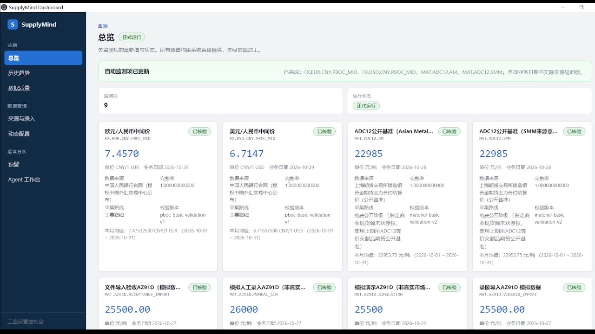
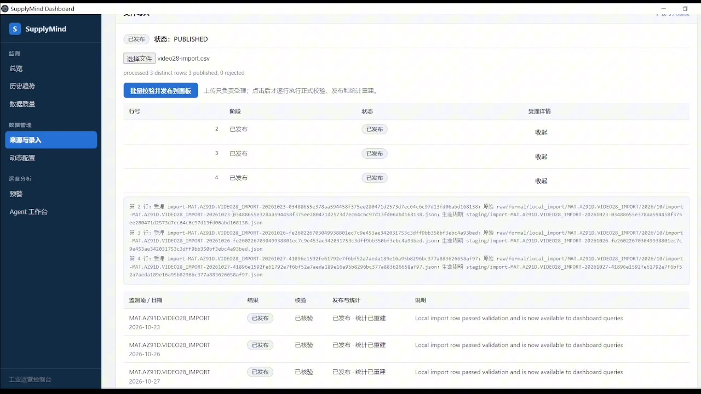
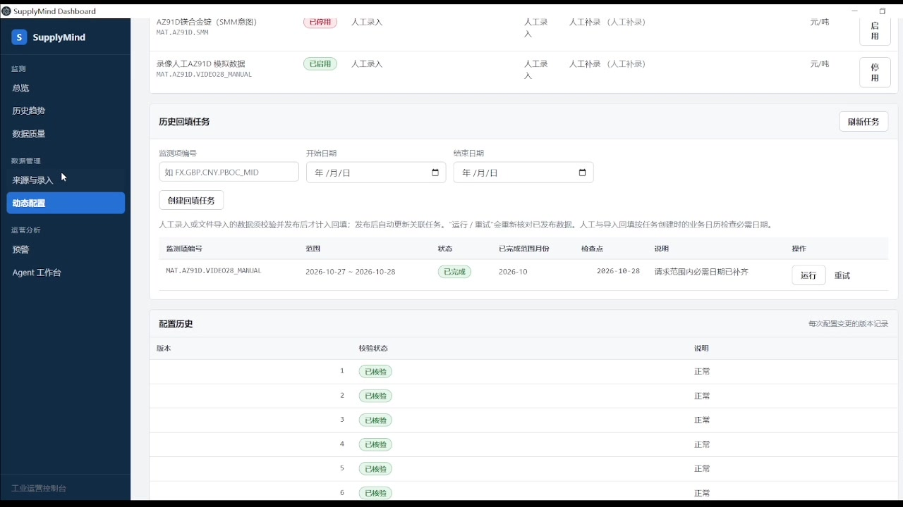
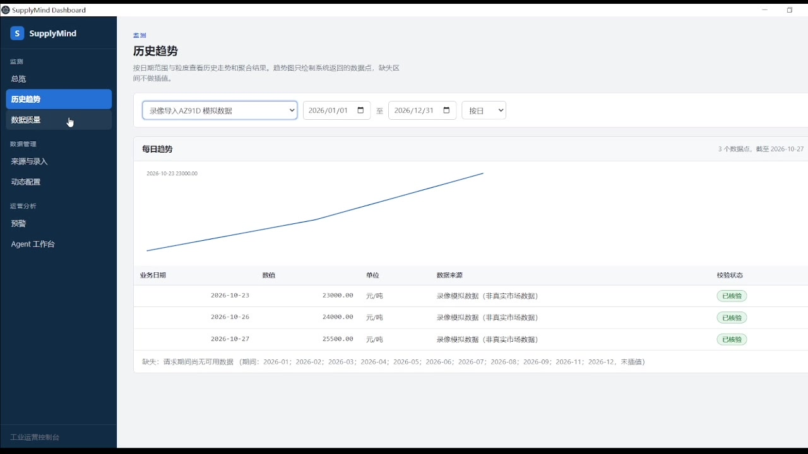
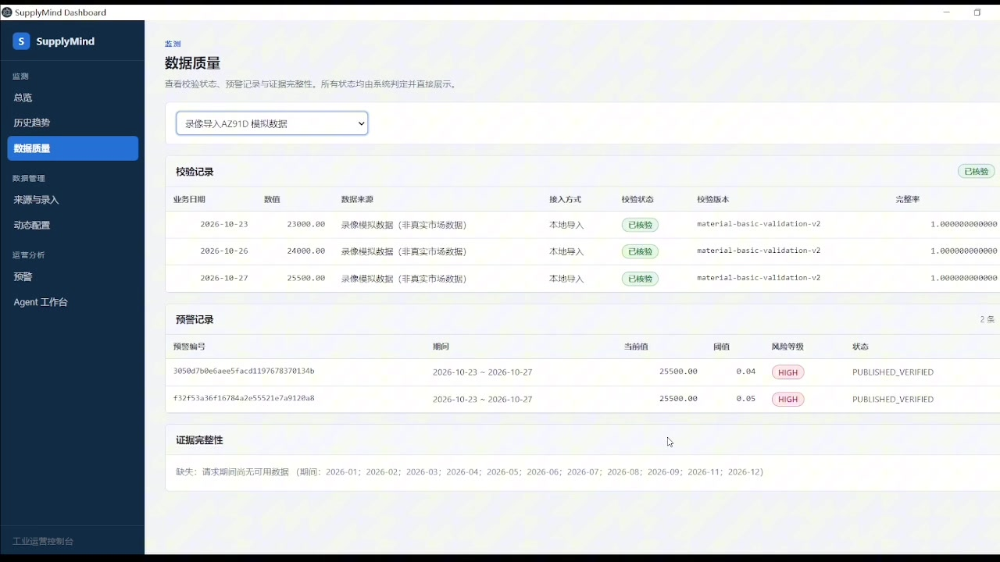
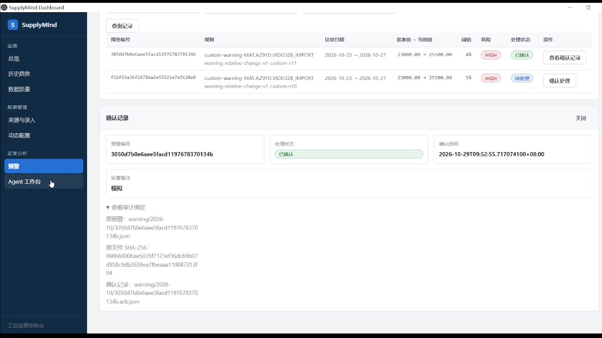
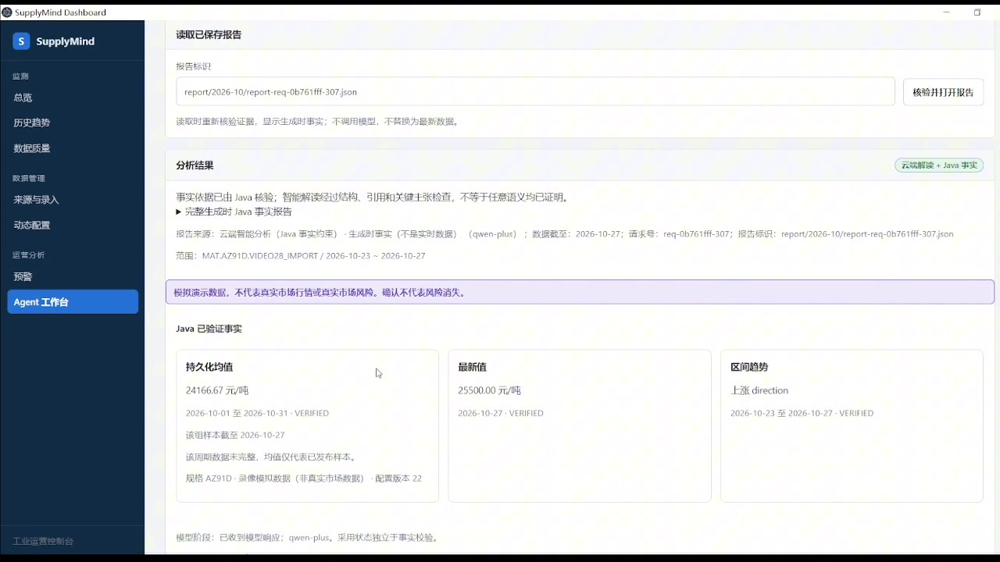
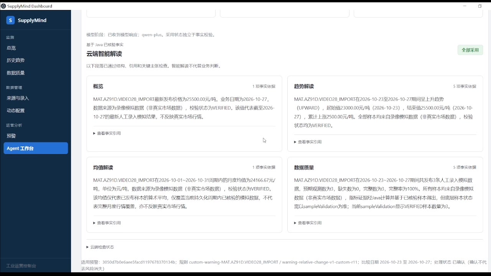
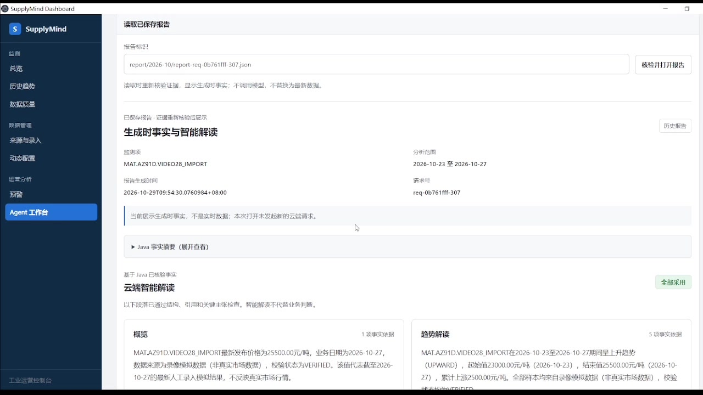

# SupplyMind AI

面向 Windows 桌面的供应链成本监测与预警平台。把汇率、材料公开基准、人工录入与文件导入放进可追溯的数据链，再用云端模型解读经过 Java 校验的事实。

**本地文件保存数据，Java 负责计算与预警，云端 AI 解读可选。**

[下载 RC12](https://github.com/osasukev57-venn/SupplyMind-AI/releases/tag/v0.9.1-rc.12) · [▶ 在线播放演示视频](https://osasukev57-venn.github.io/SupplyMind-AI/demo/) · [模型 API 与其他电脑运行](demo-data/其他电脑运行与模型API配置.md) · [版本说明](docs/RELEASE-RC12.md)

[](https://osasukev57-venn.github.io/SupplyMind-AI/demo/)

> 截图来自 RC12 实际操作录像，不是效果图。完整视频约 5 分 49 秒，附普通话 AI 男声与中文字幕。录像中的 AZ91D 数据为模拟数据，不代表真实市场行情；录制专用监测项不会自动出现在干净安装中。

## 全模块功能

| 模块 | 可以完成什么 |
| --- | --- |
| 总览 | 查看最新发布值、业务日期、单位、来源与校验状态，区分公开数据、替代基准和模拟数据。 |
| 历史趋势 | 按日期范围查看日度记录及月、季、半年、年聚合；展示来源与校验状态，不为缺失日期虚构数值。 |
| 数据质量 | 查看原始记录、校验结果和证据关联，追踪受理、校验、发布过程；不能仅凭“已受理”认定数据有效。 |
| 来源与录入 | 查看采集路线和降级原因；人工录入、CSV／XLSX 导入、逐行错误反馈、显式发布与独立演示流程。 |
| 动态配置 | 新增、启停监测项并保留版本；创建日期范围回填任务，跟踪缺口、部分完成和完成状态。 |
| 预警 | 默认及自定义周期、变化率阈值、方向、启停和规则版本；查询、确认处理、备注与审计绑定。 |
| Agent 工作台 | 7 个只读工具组织 Java 标准事实，可选云端分段解读；检查事实引用与关键主张，保存和重新打开报告。 |

## 从数据进入到报告留存

新增监测项 → 采集／录入／导入 → 待处理 → 校验发布 → 更新历史与统计 → 核对回填 → 预警评估与确认 → Agent 分析 → 保存并重新读取报告。

### 录入不是发布

人工录入填写编号、来源、业务日期、数值和单位；文件导入支持批量受理与逐行反馈。受理成功是 `PENDING`，还需点击“校验并发布到面板”或“批量校验并发布到面板”。

正式查询和统计只使用已发布且符合校验要求的记录。拒绝、冲突和独立 DEMO 数据不能混入。**单位必须与监测项配置一致：材料示例是“元/吨”，不是 CNY。**



### 回填与人工补录闭环

RC12 在人工／导入记录发布后自动核对关联回填任务。部分日期补齐显示“部分完成”；请求范围内必需业务日补齐后显示“已完成”。“运行／重试”也会重新核对已有发布数据，无需重复录入。

任务依据创建时的配置和业务日历；同月但范围外的数据、其他监测项或仅受理的数据不算补齐。详见[回填操作说明](docs/BACKFILL-RC12-OPERATION.md)。



<details>
<summary>历史趋势与数据质量截图</summary>





</details>

### 预警有规则版本，确认有审计记录

默认材料类 7 个自然日／5%，其他类 1 个自然日／1%；可逐项修改周期、阈值、方向和启停，保存后重新评估。缺少比较边界数据时明确提示“数据不足”。

预警由 Java 计算，不由模型决定。确认保留时间、备注与原预警文件的审计绑定。**确认表示已知悉，不表示风险消失。**



### Java 提供事实，云端负责解读

Agent 先查询并校验标准事实，再交给可选云模型组织语言。结果分开显示 Java 已验证事实、云端段落、事实引用、分析步骤和计算口径。



云端段落经过结构、引用、日期、单位、来源、关键数值与受控语义检查后独立采用，显示 `FULL / PARTIAL / NONE`。这不等于任意自然语言语义均被证明。模型不可用或输出不合格时保留 Java 事实报告，不伪造 AI 成功。



> 此截图证明录像中该次请求被采用，不保证任意模型、网络或后续请求都成功。云端调用需接收方自己的 API Key，可能产生费用。

<details>
<summary>已保存报告：重新读取不再次调用模型</summary>

报告保存生成时事实与证据，读取时重新校验证据，不悄悄替换成最新数据，也不发起新云端请求。



</details>

## 数据来源与统计口径

| 数据 | 实际来源与边界 |
| --- | --- |
| EUR/CNY、USD/CNY 等汇率 | 中国人民银行公开公告；新增币种需要对应来源支持。 |
| ADC12 同类公开基准 | 上海期货交易所铸造铝合金期货主力合约结算价；是期货替代基准，不是 ADC12 现货报价。 |
| Asian Metal／SMM 来源意图 | 商业现货源未授权时明确显示降级；指向同一公开源的两项不代表两个独立现货报价。 |
| AZ91D 人工／导入项 | 保留实际填写来源与配置单位；演示数据必须明确标注模拟、非真实市场数据。 |

各粒度聚合均从符合条件的日度样本直接计算，**不是月均值再逐层平均成季度／年度**。来源、规格、单位、校验状态及配置等上下文影响分组。周期未结束或样本不完整时，均值仅代表已发布样本，不代表整期行情完整覆盖。

业务真值以 UTF-8 JSON／CSV 保存在运行目录 `data/`，包括原始记录、生命周期、发布、聚合、配置、预警和报告，不依赖数据库。文件证据有 SHA-256 与一致性保护，但文件校验不等于来源内容绝对真实。

## 快速使用：Windows x64

1. 在 [RC12 Release](https://github.com/osasukev57-venn/SupplyMind-AI/releases/tag/v0.9.1-rc.12) 下载 `SupplyMindAI-0.9.1-rc.12-win32-x64.zip`。
2. 完整解压至可写目录，双击 `SupplyMindAI/SupplyMindAI.exe`，不要只复制一个 EXE。
3. 应用用随包 JRE 启动后端，监听 `127.0.0.1` 动态端口；联网可读取公开源，采集失败不阻塞已有本地数据查询。
4. 在动态配置新增并启用监测项，再录入／导入并显式发布。
5. 需要云端分析时，按[模型 API 配置说明](demo-data/其他电脑运行与模型API配置.md)配置自己的 Key 并启动；本地数据链与 Java 事实功能不要求启用模型。

终端用户无需安装 Java、Node.js、Maven、Docker、MySQL 或 Redis。换电脑请迁移完整运行目录；迁移自己的数据前先关闭应用并备份 `data/`。

**不要将 API Key 写入源码、README、截图、提交记录或分享包。** 云端分析会把所需事实发送给配置的模型服务，敏感业务数据应先评估是否适合外发。

## 从源码运行

需要 JDK 17、Node.js 和 npm，后端提供 Maven Wrapper。云模型不是启动的前置条件。

后端终端：

```powershell
cd backend
.\mvnw.cmd spring-boot:run '-Dspring-boot.run.arguments=--server.address=127.0.0.1 --server.port=8080'
```

前端另开终端：

```powershell
cd frontend
npm ci
npm run dev
```

前端默认 Vite 开发地址代理至本地后端。前端验证为 `npm test`、`npm run build`，后端在 `backend/` 执行 `.\mvnw.cmd test`。桌面壳开发与重新打包见[部署手册](docs/07-WINDOWS-DEPLOYMENT-MANUAL.md)，与用户解压运行是不同流程。

## 实际技术栈

| 层次 | 技术 |
| --- | --- |
| 桌面 | Electron 33、Temurin JRE 17、Java 子进程管理、动态端口与父进程看门狗 |
| 后端 | Java 17、Spring Boot 3.5.15、Spring AI 1.1.8、JDK HttpClient、定时任务 |
| 前端 | Vue 3、TypeScript、Vite、Vue Router、Axios、SVG 趋势图 |
| 文件与计算 | Jackson、Commons CSV、Apache POI、BigDecimal、JSON／CSV、SHA-256 |
| 云端 | 可选 OpenAI 兼容接口；录像使用通义千问 qwen-plus，不附带模型或个人 Key |
| 验证 | JUnit／Spring Boot 测试、Vitest／Vue Test Utils、便携包接口与重启回归 |

```text
backend/    获取、校验、发布、聚合、回填、预警与 Agent
frontend/   七个业务模块与事实／证据展示
desktop/    Windows 便携桌面壳
demo-data/  导入样例、启动脚本与接收方说明
docs/       操作手册、数据字典、架构决策与验收记录
release/    本地制品输出，不提交二进制到 Git 历史
```

## 视频、制品与文档

- [▶ 浏览器在线播放：普通话 AI 男声＋中文字幕](https://osasukev57-venn.github.io/SupplyMind-AI/demo/)，无需先下载，支持全屏和功能章节跳转；另保留[视频下载](https://github.com/osasukev57-venn/SupplyMind-AI/releases/download/v0.9.1-rc.12/SupplyMindAI-RC12-demo-zh-CN-male.mp4)作为备用。
- [独立 SRT 字幕](https://github.com/osasukev57-venn/SupplyMind-AI/releases/download/v0.9.1-rc.12/SupplyMindAI-RC12-demo-zh-CN.srt)及[视频章节导航](docs/DEMO-RC12.md)。
- [RC12 Release](https://github.com/osasukev57-venn/SupplyMind-AI/releases/tag/v0.9.1-rc.12)：干净 Windows 运行包、哈希清单、源码快照、视频与字幕。RC12 是候选版，旧稳定版仍保留。
- [接收方运行与模型配置](demo-data/其他电脑运行与模型API配置.md)、[回填操作](docs/BACKFILL-RC12-OPERATION.md)、[操作手册](docs/08-OPERATIONS-MANUAL.md)、[数据字典](docs/10-DATA-DICTIONARY.md)。
- 工程依据：[需求追踪](docs/02-REQUIREMENT-TRACEABILITY.md)、[验收计划](docs/03-ACCEPTANCE-TEST-PLAN.md)、[架构决策](docs/06-DECISION-LOG.md)。历史文档描述对应阶段，当前以源码及 RC12 说明为准。

## 边界与许可

这是本地监测、核验与分析辅助项目，不是自动交易／自动调价系统，未宣称接入企业 ERP／MES、实现多租户权限或取得经验证的企业收益。默认工作日日历不是完整节假日与调休日历；当前存储协议对过长监测项编号仍有限制。

源码采用 [Apache-2.0](LICENSE)。外部数据、模型服务与运行时遵循各自许可及条款；模拟数据和 AI 解读不构成业务决策依据。
